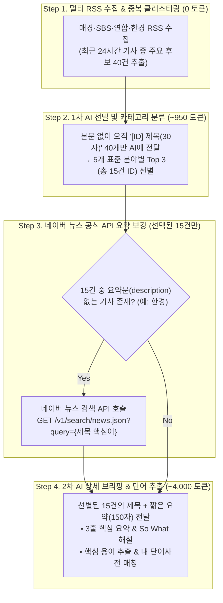
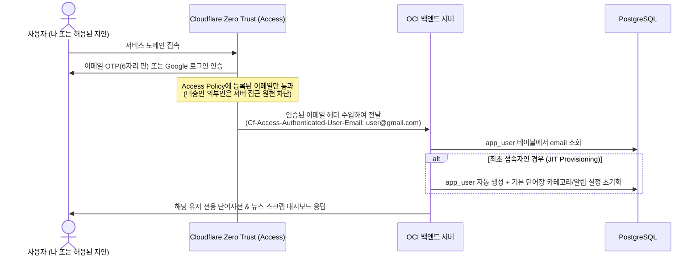
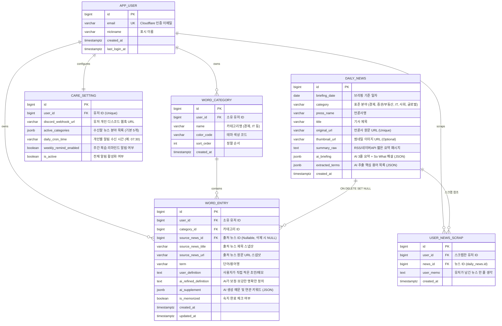

# 🌱 Dew Platform — AI 지식·인사이트 케어 비서 기획 및 아키텍처 설계서

> **"매일 쏟아지는 정보 속에서 내 지식과 하루를 돌보는 곳, AI 라이프·지식 케어 파트너 (Dew Platform)"**
>
> 오늘 알아야 할 세상의 흐름(주요뉴스)을 내 눈높이로 소화하고, 그 과정에서 얻은 개념을 나만의 언어로 정제(단어사전)하여 내 지식으로 쌓아주는 **선순환 개인 케어 플랫폼**입니다.

---

## 1. 🎯 핵심 도메인 상세 기획

### 1.1 나만의 단어사전 (Custom AI Vocabulary Vault)
사용자가 일상이나 뉴스에서 접한 용어를 대략적인 메모와 함께 등록하면, AI가 사전 수준으로 교정·보강해 주는 개인 지식 창고입니다.

- **사용자 정의 카테고리 관리**
  - 사용자가 원하는 주제별 폴더/카테고리(예: `경제/금융`, `IT/개발`, `시사/교양`, `비즈니스 어휘`)를 색상 뱃지·아이콘과 함께 자유롭게 생성 및 정렬
- **단어 등록 및 AI 내용 보정 워크플로우**
  1. **사용자 입력**: 단어명(필수) + 내가 이해한 뜻/메모(선택)
  2. **AI 내용 보정 (Before / After 비교 제공)**:
     - **내 메모 교정**: 사용자가 적은 설명 중 오개념이나 부정확한 표현을 자연스럽게 교정
     - **한 줄 핵심 정의**: 직관적이고 쉬운 한 줄 요약
     - **실전 활용 예문**: 뉴스나 실제 대화에서 쓰이는 예문 2가지 제공
     - **연관/반대 키워드**: 함께 알아두면 좋은 개념 태그 추천
  3. **선택적 반영**: AI 보정본으로 덮어쓰기 또는 내 메모 하단에 병합 저장

---

### 1.2 당일 주요뉴스 & AI 눈높이 브리핑 + 휴대폰 알림
관심 분야의 일일 주요 뉴스를 합법적으로 수집·엄선하여 AI 해설과 함께 제공하고, 디스코드 웹훅으로 휴대폰 푸시 알림을 발송합니다.

- **일일 뉴스 볼륨 황금 비율: 5대 핵심 분야 × 분야당 3건 (하루 총 15건)**
  - **5대 기본 표준 분야**:
    1. 📈 **경제/금융** (금리, 물가, 정부 정책, 산업 동향)
    2. 💰 **증권/부동산** (국내외 증시, 환율, 부동산 시장)
    3. 💻 **IT/테크** (AI, 반도체, 빅테크, 신기술 트렌드)
    4. 🏛️ **사회/생활** (법·제도 변화, 노동, 실생활 밀착 이슈)
    5. 🌍 **글로벌(국제)** (미국·중국 정세, 지정학 이슈, 글로벌 빅이벤트)
  - **왜 분야당 3건(총 15건)인가?**
    - **인지 피로도 최소화**: 아침 출근/등교길 3~5분 내에 부담 없이 다 읽을 수 있는 분량
    - **디스코드 Embed 제한 준수**: 디스코드 웹훅 1회 발송당 최대 10개 Embed 제한을 여유 있게 통과 (분야별 카드 1장씩 총 5장 발송 가능)
    - **AI 토큰 및 응답 속도 최적화**: 소량의 배치 호출만으로 10초 내외에 전체 브리핑 생성 완료
- **AI 눈높이 해설 (So What?)**
  - **3줄 핵심 요약**: 바쁜 아침 10초 만에 읽는 핵심 요점
  - **왜 중요할까? (So What?)**: 이 뉴스가 내 일상·자산·커리어에 미치는 영향 코멘트
  - **핵심 용어 콕 집기**: 기사 속 어려운 전문 용어 1~2개 자동 추출 및 뜻 풀이
- **선별 스크랩 (Archive & Memo)**
  - 휘발되는 일일 뉴스 중 사용자가 **[저장]**을 누른 뉴스만 영구 보관함에 적재하고, 나만의 한 줄 코멘트 기록 가능

---

### 1.3 나를 '케어'하는 연결 기능 (Synergy Features)
단순 기록 도구를 넘어 사용자를 능동적으로 챙겨주는 핵심 연결 고리입니다.

1. **뉴스 → 단어사전 원클릭 연동**
   - 뉴스 브리핑 하단의 `AI 추천 핵심 용어` 옆 **[+ 내 단어사전에 추가]** 클릭 시, AI 보정 정의와 출처 뉴스 정보가 연결된 상태로 단어사전에 즉시 저장
2. **뉴스 읽을 때 '내 단어사전' 형광펜 하이라이팅**
   - 당일 주요뉴스에 **내가 이미 단어사전에 등록해 둔 단어가 등장하면 형광펜 하이라이트** 표시 (마우스 오버/터치 시 내가 정리한 뜻 툴팁 노출)
3. **주간 지식 리마인드 브리핑 (Weekly Care)**
   - 매주 금요일/일요일 저녁 디스코드 알림으로 *"이번 주에 새로 수집한 단어 N개와 스크랩한 뉴스 M건이에요. 가볍게 복습해 볼까요?"* 리마인드 카드 발송

---

## 2. 📡 데이터 수집 파이프라인 및 카테고리 통일 설계

> [!IMPORTANT]
> **법적·기술적 안전 원칙 (Zero Copyright Risk)**
> 1. 웹사이트 HTML 무단 크롤링(Scraping)을 지양하고 **언론사 공식 RSS 피드**와 **네이버 검색 공식 오픈 API**만 사용합니다.
> 2. RSS에 본문 텍스트가 포함된 경우라도 **오직 서버 메모리(RAM) 상에서 AI 요약·용어 추출 입력용으로만 사용한 뒤 즉시 폐기**하며, DB에는 `제목 + 원문 링크 + 공식 짤막 요약 + AI 자체 해설`만 저장합니다.

### 2.1 국내 주요 언론사 및 포털 RSS 실측 검증표

실제 각 언론사 RSS 엔드포인트의 라이브 XML 응답을 전수 조사한 결과입니다.

| 출처 | 분야별 공식 RSS URL | 제공 필드 (실측 결과) | 특징 및 처리 전략 |
| :--- | :--- | :--- | :--- |
| **매일경제** | • 헤드라인: `https://www.mk.co.kr/rss/30000001/`<br>• 경제: `https://www.mk.co.kr/rss/30100041/`<br>• 증권: `https://www.mk.co.kr/rss/50200011/`<br>• 부동산: `https://www.mk.co.kr/rss/50300009/`<br>• 과학/IT: `https://www.mk.co.kr/rss/50100032/` | `title`, `link`, `category`, `pubDate`, **`description` (요약 포함)**, `media:content` (썸네일) | **[1순위 수집원]** 부제목+첫 문단 요약과 썸네일이 모두 정제되어 있어 바로 활용 가능 |
| **SBS 뉴스** | • 헤드라인: `https://news.sbs.co.kr/news/headlineRssFeed.do?plink=RSSREADER`<br>• 경제: `.../SectionRssFeed.do?sectionId=02&plink=RSSREADER`<br>• 사회: `.../SectionRssFeed.do?sectionId=03&plink=RSSREADER`<br>• 국제: `.../SectionRssFeed.do?sectionId=07&plink=RSSREADER` | `title`, `link`, **`description`**, **`category` (키워드 해시태그 다수)**, `enclosure` (썸네일), `content:encoded` | **[1순위 수집원]** 기사별 핵심 키워드 태그가 기본 제공되어 이슈 클러스터링에 매우 유리함 (원문은 인메모리 요약 후 즉시 폐기) |
| **연합뉴스TV** | • 최신: `https://www.yonhapnewstv.co.kr/browse/feed/`<br>• 경제: `http://www.yonhapnewstv.co.kr/category/news/economy/feed/`<br>• 사회: `http://www.yonhapnewstv.co.kr/category/news/society/feed/` | `title`, `link`, `enclosure` (썸네일), **`description` (200자 요약)**, `content:encoded` | **[1순위 수집원]** 방송 리포트 요약문이 명확하여 AI 브리핑 생성 품질이 높음 |
| **한국경제** | • 경제: `https://www.hankyung.com/feed/economy`<br>• IT: `https://www.hankyung.com/feed/it`<br>• 증권: `https://www.hankyung.com/feed/finance`<br>• 국제: `https://www.hankyung.com/feed/international` | `title`, `link`, `author`, `pubDate` (**⚠️ `description` 없음**) | **[보강 필요]** 제목만 존재하므로 선별된 헤드라인 제목을 **네이버 뉴스 검색 API**에 질의하여 `description` 패시지를 보충 |
| **구글 뉴스 (KR)** | • 주요뉴스: `https://news.google.com/rss?hl=ko&gl=KR&ceid=KR:ko`<br>• 과학·기술: `https://news.google.com/rss/topics/CAAqJggKIiBDQkFTRWdvSUwyMHZNRGRqTVhZU0FtVnVHZ0pWVXlnQVAB?hl=ko&gl=KR&ceid=KR:ko` | `title`, `link`, `pubDate`, `source` | 종합 이슈 교차 검증 및 IT/과학 분야 보조 수집용으로 활용 |

---

### 2.2 언론사마다 다른 카테고리(섹션) 통일 전략

언론사별로 섹션 구성이 다른 문제(예: SBS에는 `IT` 섹션이 없고 `경제`에 포함됨, 동일 기사가 매경은 `경제`·한경은 `IT`로 분류됨)를 해결하기 위해 **N:M 수집 매핑 + AI 통합 재분류** 방식을 적용합니다.

1. **1차 수급 (N:M RSS 매핑 테이블)**
   - 각 언론사에 존재하는 섹션 RSS들을 최대한 넓게 수집하여 하나의 후보 풀(Pool)에 모읍니다.
   - 예: `IT/테크` 수급은 매경 `과학/IT` + 한경 `IT` + 구글뉴스 `과학·기술`에서 가져오고, SBS `경제`에서 나온 테크 기사도 후보 풀에 함께 넣습니다.
2. **2차 재분류 (AI 표준 카테고리 배정)**
   - 언론사가 붙여놓은 원래 카테고리에 의존하지 않고, **AI가 기사 제목을 보고 우리 서비스의 5대 표준 카테고리(`경제/금융`, `증권/부동산`, `IT/테크`, `사회/생활`, `글로벌`) 중 가장 알맞은 곳으로 직접 분류**합니다.
   - 추후 사용자가 커스텀 뉴스 카테고리(예: `반도체/AI`, `취업/채용`)를 추가하더라도 RSS 수집기 코드 수정 없이 프롬프트에만 반영하면 즉시 분류가 가능합니다.

---

### 2.3 토큰 95% 절감형 "2-Step 다이어트" 파이프라인 & 네이버 API 보강

수집된 수백 건의 기사 본문을 모두 AI에 넣으면 토큰이 낭비되므로, **① 제목만으로 먼저 15건을 추린 뒤 → ② 뽑힌 15건만 요약문을 붙여 해설을 생성하는 2단계 파이프라인**으로 설계합니다.



#### 📊 일일 AI 토큰 소모량 계산표 (5개 분야 × 3건 = 총 15건 기준)

| 단계 | 작업 내용 | 입력(Input) | 출력(Output) | 합계 |
| :--- | :--- | :---: | :---: | :---: |
| **Step 2 (1차 선별)** | 뉴스 후보 40개의 **제목만** 넣고 5개 분야 × 3개 ID 분류 | ~900 토큰 | ~50 토큰 | **~950 토큰** |
| **Step 4 (2차 해설)** | 최종 뽑힌 **15개 기사만** 요약문(150자) 붙여 해설·단어 생성 | ~1,800 토큰 | ~2,200 토큰 | **~4,000 토큰** |
| **일일 총합** | **하루 1회 모닝 브리핑 전체 생성** | **2,700 토큰** | **2,250 토큰** | **🔥 약 4,950 토큰 / 일** |

> 💡 **하루 4,950 토큰**은 Gemini Flash 무료 티어 분당 한도(TPM)의 **0.5% 미만**이며, 유료 API로 환산해도 **하루 약 1원(월 30원)** 미만의 극소량입니다.

---

## 3. 🤖 AI 엔진 연동 아키텍처 (내 계정 Antigravity SDK + 무료 API 하이브리드)

종량제 API 키 방식뿐만 아니라, 서버에 **내 개인 구독 계정(Antigravity / Gemini Pro)**을 연동하여 추가 비용 없이 고성능 Pro 모델을 안전하게 활용하는 하이브리드 구조를 지원합니다.

### 3.1 Antigravity Python SDK (`google-antigravity`) 안전 연동 설계

서버 백그라운드에서 에이전트 SDK를 실행할 때 **① 서버 파일/리소스를 임의로 건드리거나 ② 사용자 리뷰/승인(`ask_user`)을 기다리며 멈추는(Hang) 현상**을 원천 차단하기 위해 **`deny("*")` 정책 잠금장치**를 적용합니다.

```python
import asyncio
from google.antigravity import Agent, LocalAgentConfig
from google.antigravity.hooks.policy import deny

async def ask_gemini_pro_safely(prompt: str) -> str:
    config = LocalAgentConfig(
        system_instructions=(
            "너는 개인 뉴스 요약 및 단어장 보정 전용 AI 비서야. "
            "어떠한 도구도 호출하지 말고 오직 요청받은 JSON 텍스트만 반환해."
        ),
        # 🔒 안전 잠금장치: 모든 툴(파일 읽기/쓰기, 명령어 실행, 승인 요청 등)을 100% 차단!
        # 서버 리소스 변경 가능성 0%, 승인 대기로 인한 멈춤(Hang) 가능성 0%
        policies=[
            deny("*")
        ]
    )

    chunks = []
    # 30초 타임아웃 안전장치 추가 (지연 시 즉시 무료 API로 Fallback)
    async with asyncio.timeout(30.0):
        async with Agent(config) as agent:
            response = await agent.chat(prompt)
            async for token in response:
                chunks.append(token)
    return "".join(chunks)
```

### 3.2 작업 성격별 하이브리드 라우팅 전략

| 작업 구분 | 추천 AI 엔진 | 선정 이유 |
| :--- | :--- | :--- |
| **일일 주요뉴스 브리핑 생성**<br>(새벽/아침 백그라운드 스케줄러) | **내 계정 Antigravity SDK (Gemini Pro)**<br>*(타임아웃 시 Gemini/Groq API 폴백)* | 사용자가 기다리지 않는 배치 작업이므로 초기 구동 시간(3~5초)이 무방하며, **Pro 모델의 높은 추론력으로 깊이 있는 'So What(왜 중요할까)' 해설** 생성 가능 |
| **단어사전 실시간 내용 보정**<br>(웹에서 버튼 클릭 시 즉시 응답) | **Groq Cloud API / Gemini Flash API**<br>*(무료 티어)* | 사용자가 화면 앞에서 기다리는 작업이므로 **0.5~1초 내 즉시 응답**이 오는 경량 고속 API가 최적 |

> **📌 Docker 배포 시 인증 유지 팁**: 컨테이너가 재시작되어도 Antigravity 로그인이 풀리지 않도록 호스트 서버에서 1회 로그인 후 `docker-compose.yml`에 `~/.gemini:/root/.gemini` 볼륨 마운트를 설정합니다.

---

## 4. 🔐 무가입 멀티 유저 계정 설계 (Cloudflare Zero Trust 연동)

별도의 회원가입·로그인 화면이나 비밀번호 관리 로직을 직접 구현하지 않고, 도메인 앞단의 **Cloudflare Zero Trust (Access)**를 활용해 보안과 멀티 유저 구분을 동시에 해결합니다.

### 4.1 Cloudflare Access 헤더 기반 자동 계정 생성 (JIT Provisioning)



- **회원가입 UI 불필요**: Cloudflare Access(최대 50명 무료)의 Access Policy에 허용할 이메일만 등록해 두면 Cloudflare가 앞단에서 인증을 전담합니다.
- **백엔드 유저 식별**: 백엔드 인터셉터/필터는 `Cf-Access-Authenticated-User-Email` 헤더만 읽어 유저를 식별하며, DB에 없는 이메일이면 최초 요청 시점에 자동으로 유저 레코드를 생성(**Just-In-Time Provisioning**)합니다.
- **로컬 개발 폴백**: 로컬 환경에서는 헤더가 없을 경우 환경변수(`DEV_DEFAULT_EMAIL=dev@local`)로 자동 매핑하여 개발 편의성을 유지합니다.

---

## 5. 🗄️ 멀티 유저 데이터베이스 설계 (ERD) 및 자동 삭제(TTL) 정책

### 5.1 멀티 유저 비용 최적화 & 뉴스 데이터 3단계 생명주기

1. **공통 뉴스 수집 (`daily_news`) — 유저 수와 무관하게 하루 1번만 AI 호출**:
   - 하루 15건의 주요뉴스 수집 및 AI 브리핑 생성은 서버 전체에서 하루 1번만 수행하여 모든 유저가 공유합니다. (유저가 10명이어도 일일 토큰 소모량은 4,950 토큰으로 고정!)
2. **개인별 스크랩 분리 (`user_news_scrap`)**:
   - 특정 뉴스의 저장(북마크) 여부와 한 줄 메모는 유저별 매핑 테이블(`user_news_scrap`)로 분리합니다.
3. **미저장 뉴스 자동 삭제 (Multi-User Safe TTL 스케줄러)**:
   - 매일 자정 스케줄러가 돌면서 **어느 유저도 스크랩하지 않은(`NOT EXISTS`)** 기한 경과 임시 뉴스만 DB에서 영구 삭제합니다. (단 1명의 유저라도 스크랩한 뉴스는 보존)
   - **단어사전 출처 보호**: 뉴스에서 단어만 단어사전(`word_entry`)에 추가하고 뉴스 자체는 스크랩하지 않아 삭제되더라도 출처가 유실되지 않도록, `word_entry` 테이블에 `source_news_title`과 `source_news_url`을 스냅샷으로 함께 보관하고 FK에는 `ON DELETE SET NULL`을 적용합니다.

```sql
-- 매일 자정 실행: 어느 유저도 스크랩하지 않은 지난 임시 뉴스 일괄 삭제
DELETE FROM daily_news dn
WHERE dn.briefing_date < CURRENT_DATE - INTERVAL '3 days'
  AND NOT EXISTS (
      SELECT 1 FROM user_news_scrap uns WHERE uns.news_id = dn.id
  );
```

### 5.2 멀티 유저 ERD 다이어그램



---

## 6. 📱 디스코드(Discord) 휴대폰 알림 설계

디스코드 웹훅의 **1회 최대 10개 Embed 제한**에 맞춰, 각 유저가 구독 설정한 분야별로 **카드(Embed) 1장씩(최대 5장)** 구성하고 각 카드 안에 해당 분야의 Top 3 뉴스와 핵심 단어를 담아 각 유저의 디스코드 웹훅으로 발송합니다.

### 디스코드 Webhook Payload 구조 예시 (`POST /api/webhooks/{id}/{token}`)

```json
{
  "username": "나만의 AI 케어 비서",
  "content": "☀️ **10월 17일 오늘의 5대 분야 주요뉴스 브리핑 (총 15건)**",
  "embeds": [
    {
      "title": "📈 [경제/금융] 오늘의 핵심 뉴스 Top 3",
      "color": 3447003,
      "fields": [
        {
          "name": "1️⃣ 1~2세대 실손보험 할인형 특약 및 5세대 전환 다음 달 도입",
          "value": "• 초기 실손 가입자 보험료 부담 완화 특약 도입\n• 💡 **Point**: 내 실손 세대를 확인하고 병원 이용 빈도에 따라 유불리를 따져보세요.\n• 📕 **핵심단어**: `비급여 항목` (건보 미적용 환자 전액 부담 항목)\n• 🔗 [원문 보기](https://www.mk.co.kr/news/economy/12178564)",
          "inline": false
        },
        {
          "name": "2️⃣ ...",
          "value": "...",
          "inline": false
        }
      ],
      "footer": {
        "text": "웹 대시보드에서 마음에 드는 뉴스를 [저장]하거나 단어를 [단어사전]에 추가해 보세요!"
      }
    }
  ]
}
```

---

## 7. 🖥️ 주요 API 엔드포인트 설계

*(모든 API는 `Cf-Access-Authenticated-User-Email` 헤더를 통해 현재 로그인 유저 컨텍스트로 동작합니다.)*

| 도메인 | Method | Endpoint | 설명 |
| :---: | :---: | :--- | :--- |
| **계정/프로필** | `GET` | `/api/me` | 현재 Cloudflare 인증 유저 정보 조회 (최초 호출 시 자동 계정 생성) |
| **단어사전** | `GET` | `/api/categories` | 내 정의 카테고리 목록 및 단어 개수 조회 |
| **단어사전** | `POST` | `/api/categories` | 새 카테고리 생성 (이름, 색상, 순서) |
| **단어사전** | `POST` | `/api/words/preview-ai` | 단어 등록 전 **AI 내용 보정 미리보기** (내 메모 교정 + 정의 + 예문 생성) |
| **단어사전** | `POST` | `/api/words` | 단어 최종 저장 (사용자 메모 + AI 보정본) |
| **단어사전** | `GET` | `/api/words` | 내 카테고리별/검색어별 단어 목록 조회 |
| **주요뉴스** | `GET` | `/api/news/daily` | 날짜별·분야별 주요 뉴스(5분야×3건) 조회 (내 스크랩 여부 + 내 단어장 하이라이트 매칭 포함) |
| **주요뉴스** | `POST` | `/api/news/collect` | 즉시 뉴스 수집 & AI 브리핑 생성 수동 트리거 |
| **주요뉴스** | `POST` | `/api/news/{id}/scrap` | 특정 뉴스를 내 보관함에 영구 스크랩(`user_news_scrap`) 토글 및 메모 저장 |
| **주요뉴스** | `GET` | `/api/news/scraps` | 내가 영구 스크랩한 뉴스 보관함 목록 조회 |
| **주요뉴스** | `POST` | `/api/news/{id}/to-word` | 뉴스 내 핵심 용어를 내 단어사전 특정 카테고리로 원클릭 등록 (출처 스냅샷 포함) |
| **알림/설정** | `POST` | `/api/notifications/test` | 내 디스코드 웹훅으로 테스트 브리핑 즉시 발송 |
| **알림/설정** | `PUT` | `/api/settings` | 내 관심 분야, 개인 알림 시각, 디스코드 웹훅 URL 설정 변경 |

---

## 8. ☁️ OCI (Oracle Cloud Infrastructure) + Cloudflare 배포 특화 설계

운영 서버가 **OCI(오라클 클라우드)**이고 앞단에 **Cloudflare**를 두는 아키텍처이므로 아래와 같이 구성합니다.

### 8.1 Cloudflare Tunnel (`cloudflared`) + Zero Trust 연동
- OCI 서버에 `cloudflared` 데몬(또는 Docker 컨테이너)을 띄워 아웃바운드 터널로 연결하면, **OCI의 공인 IP나 포트를 외부에 직접 노출하지 않고도** 안전하게 HTTPS 도메인 및 Cloudflare Access 인증을 적용할 수 있습니다.

### 8.2 CPU 아키텍처 확인 (`ARM64` vs `x86_64`) 및 AI 어댑터 추상화
- OCI 프리티어에서 주로 사용하는 **Ampere A1 인스턴스는 `ARM64 (aarch64)` 아키텍처**입니다.
- `google-antigravity` SDK나 CLI는 내부에 플랫폼별 컴파일된 바이너리를 포함하므로, 배포 전 `uname -m`으로 아키텍처 호환성을 먼저 확인합니다.
- **안전한 폴백(Fallback) 구조**: 만약 Linux ARM64 컨테이너 환경에서 바이너리 호환 이슈나 인증 토큰 만료가 발생하더라도 서비스가 멈추지 않도록, **순수 HTTP REST 방식으로 동작하는 Gemini Flash / Groq 무료 API(하루 5,000 토큰으로 무료 한도의 0.5% 미만 소모)로 자동 전환되는 어댑터 패턴**을 기본 적용합니다.

### 8.3 Headless(브라우저 없는) OCI 서버의 인증 세션 주입 방법
OCI 리눅스 서버에는 GUI 웹 브라우저가 없으므로 아래 두 가지 방법 중 하나로 인증 세션을 세팅합니다.
1. **로컬 인증 폴더 복사 (`scp`)**: 로컬 PC에서 로그인하여 생성된 `~/.gemini` 인증 정보를 OCI 서버의 `/home/ubuntu/.gemini`로 복사 후 Docker 볼륨 마운트 (`volumes: - /home/ubuntu/.gemini:/root/.gemini`)
2. **SSH 포트 포워딩 인증**: `ssh -i key.pem -L 8085:localhost:8085 ubuntu@<OCI_IP>` 접속 후 CLI 로그인을 진행하여 로컬 PC 브라우저의 OAuth 콜백을 OCI 서버로 전달

### 8.4 타임존(`Asia/Seoul`) 필수 고정
- OCI 기본 시스템 시간은 `UTC`이므로, 아침 모닝 브리핑 스케줄러가 정확한 한국 시간(KST)에 동작하도록 호스트(`sudo timedatectl set-timezone Asia/Seoul`)와 `docker-compose.yml`(`TZ=Asia/Seoul`) 양쪽에 모두 타임존을 고정합니다.

---

## 9. 🛠️ 확정 기술 스택 및 프로젝트 초기 세팅 (INIT) 가이드

### 9.1 확정 기술 스택 (Spring Boot 개발자를 위한 1:1 매칭표)

| 영역 | 확정 기술 스택 | 기존 Java / Spring 대응 개념 |
| :--- | :--- | :--- |
| **Backend Framework** | **Python 3.12 + FastAPI + Uvicorn** | Java 17 + Spring Boot Web + Tomcat |
| **ORM / DTO 검증** | **SQLModel (SQLAlchemy 2.0 + Pydantic v2)** | Spring Data JPA (Hibernate) + Lombok + `@Valid` DTO |
| **Background Scheduler** | **APScheduler (`AsyncIOScheduler`)** | Spring `@Scheduled(cron = "...")` |
| **HTTP Client & RSS 파서** | **`httpx` (비동기 HTTP) + `feedparser` (RSS XML 파서)** | Spring `WebClient` + `Rome` / `Jsoup` |
| **AI / LLM SDK** | **`google-antigravity` SDK + Gemini / Groq REST API** | WebClient SSE / REST 호출 |
| **Database** | **PostgreSQL 15 (Alpine)** | PostgreSQL 15 (동일) |
| **Frontend** | **Next.js (App Router) + React + TypeScript + Tailwind CSS** | Next.js (동일) |

---

### 9.2 권장 프로젝트 디렉터리 구조 (`dew-platform/`)

```text
dew-platform/
├── docs/
│   ├── spec/
│   │   └── DEW_PROJECT_SPEC.md # 현재 기획 및 아키텍처 설계 문서 (워크스페이스 컨텍스트 인계용)
│   └── implementation/         # 단계별 실제 구현 상세 문서 폴더
├── docker-compose.yml          # db(PostgreSQL) + backend(FastAPI) + frontend(Next.js) 통합 실행
├── .env                        # DB 접속 정보, 네이버 API 키, Gemini/Groq 키, 개발용 기본 이메일
├── init/
│   └── 01_schema.sql           # 초기 테이블 생성 SQL
├── fastapi-app/                # Python FastAPI 백엔드 서버
│   ├── Dockerfile
│   ├── requirements.txt
│   └── app/
│       ├── main.py             # FastAPI 앱 엔트리포인트, CORS, Lifespan(스케줄러 시작/종료)
│       ├── core/
│       │   ├── config.py       # 환경변수 로드 (pydantic-settings)
│       │   ├── database.py     # SQLModel Engine 및 DB Session 의존성 (get_session)
│       │   └── auth.py         # Cloudflare 헤더(Cf-Access-Authenticated-User-Email) JIT 유저 매핑
│       ├── models/             # SQLModel 엔티티 & DTO 정의 (user, word, news, setting)
│       ├── routers/            # API 컨트롤러 (words.py, news.py, settings.py)
│       └── services/
│           ├── rss_collector.py    # feedparser 멀티 RSS 수집 + 네이버 뉴스 API 보강
│           ├── ai_engine.py        # Antigravity SDK(deny("*")) + Gemini/Groq 폴백 엔진
│           ├── discord_notifier.py # 디스코드 Rich Embed 웹훅 발송기
│           └── scheduler.py        # APScheduler (모닝 브리핑 생성 & 자정 미저장 뉴스 자동 삭제)
└── next-js-app/                # Next.js 프론트엔드 대시보드
    ├── Dockerfile
    ├── package.json
    └── app/
        ├── page.tsx            # 메인 대시보드 (오늘의 5대 분야 뉴스 + 내 단어 하이라이트)
        ├── words/page.tsx      # 카테고리별 단어사전 & AI 보정 비교 뷰
        ├── scraps/page.tsx     # 내가 스크랩한 영구 보관 뉴스 뷰
        └── settings/page.tsx   # 디스코드 웹훅 URL 및 관심 분야 설정 뷰
```

---

### 9.3 새 프로젝트 폴더에서 바로 실행하는 Step-by-Step INIT 명령어

새 폴더(예: `c:\Users\332br\workspace\dew-platform`)를 만들고 아래 순서대로 실행하거나, 워크스페이스에서 Antigravity에게 **`"@docs/spec/DEW_PROJECT_SPEC.md 문서의 섹션 9대로 프로젝트 초기 세팅해 줘"`**라고 지시하면 한 번에 생성됩니다.

#### Step 1. 루트 폴더 생성 및 설계 문서 배치
```powershell
mkdir c:\Users\332br\workspace\dew-platform\docs\spec
cd c:\Users\332br\workspace\dew-platform
# 이 DEW_PROJECT_SPEC.md 파일을 docs/spec/ 폴더 안에 넣어둡니다.
```

#### Step 2. FastAPI 백엔드 초기 환경 구성 (`fastapi-app/`)
```powershell
mkdir fastapi-app
cd fastapi-app

# 1. 파이썬 가상환경 생성 및 활성화 (Windows PowerShell 기준)
python -m venv .venv
.\.venv\Scripts\Activate.ps1

# 2. 필수 패키지 설치
pip install fastapi "uvicorn[standard]" sqlmodel psycopg2-binary pydantic-settings httpx feedparser apscheduler google-antigravity

# 3. 의존성 목록 저장
pip freeze > requirements.txt
```

#### Step 3. Next.js 프론트엔드 초기 환경 구성 (`next-js-app/`)
```powershell
cd c:\Users\332br\workspace\dew-platform
npx create-next-app@latest next-js-app --typescript --tailwind --eslint --app --no-src-dir --import-alias "@/*"
```

#### Step 4. 워크스페이스에서 AI에게 대화 맥락 이어받기 (프롬프트 팁)
Antigravity에서 `dew-platform` 폴더를 워크스페이스로 열고 첫 메시지로 아래와 같이 입력하시면 됩니다:
> `"@docs/spec/DEW_PROJECT_SPEC.md 문서를 읽고 전체 기획과 설계를 파악해 줘. 먼저 섹션 9의 구조대로 docker-compose.yml, init/01_schema.sql, 그리고 FastAPI 백엔드 스켈레톤(fastapi-app)부터 세팅을 시작하자!"`
